# 공부 집중 사이트 차단기

hosts 파일(Windows)과 VPN·접근성(안드로이드)으로 유튜브·SNS·커뮤니티 등 딴짓 사이트를 차단합니다.

## Windows — 몰입 (`dist/StudyBlocker.exe`)

첨부 디자인(Nocturne)을 그대로 쓴 창 프로그램입니다. 화면은 Windows에 내장된 WebView2로 그리고, 타이머·차단은 Go로 동작합니다.

- 실행: `dist/StudyBlocker.exe` 더블클릭 → 관리자 권한 확인에서 "예" (hosts 파일을 고치려면 필요)
- 처음 실행하면 온보딩: 막을 카테고리 → 타이머 방식 → 첫 집중 시작
- **집중**: 뽀모도로(25/5분, 4세션마다 긴 휴식) · 자유(25분~2시간) · 스톱워치. 타이머를 시작하면 집중 모드가 켜져 차단, 휴식 중엔 잠시 해제(설정에서 변경)
- **차단 목록**: 목록 프리셋(기본·시험 기간·코딩, 새로 추가 가능), 카테고리 6종(SNS·영상·커뮤니티·쇼핑·뉴스·게임) 일괄 차단, 사이트 직접 추가, 허용 목록
- **예약**: 요일·시간대를 정해 두면 타이머 없이도 그 시간에 자동 차단(예: 평일 09:00–12:00, 매일 23:00–다음 날 07:00). 예약마다 막을 목록을 고를 수 있고, 해제 방식(잠금 등)이 똑같이 적용됨. 몰입이 실행 중일 때만 동작하므로 '컴퓨터 시작 시 실행'을 켜 두는 것을 권장
- **긴급 잠금 해제**: 잠금 중이라도 정당한 사유(10자 이상)와 해제 시간(1~60분)을 입력하면 차단을 잠시 멈춤. 시간이 지나면 자동으로 다시 차단('지금 다시 차단'으로 일찍 끝낼 수도 있음). 해제 중에도 목록·예약·설정을 느슨하게 바꾸거나 종료하는 것은 계속 막힘. 언제·몇 분(요청/실제)·무슨 사유였는지는 **기록** 화면의 '긴급 잠금 해제 기록'에 남음
- **기록**: 오늘·이번 주 집중 시간, 7일 막대그래프, 가장 많이 막은 사이트, 오늘의 세션
- **설정**: 타이머 길이, 해제 방식(바로 해제 / 15초 대기 후 해제 / 타이머 도는 동안 잠금), 차단 화면 문구, 컴퓨터 시작 시 실행, 알림음
- 차단된 사이트에 접속하면 몰입 창이 앞으로 나와 차단 화면을 보여 주고, '막은 접속 시도'로 집계
- 창을 닫으면 트레이(작업 표시줄 오른쪽)에서 계속 실행. 완전히 끝내려면 트레이 아이콘 우클릭 → 종료 (끝내면 차단이 풀림)
- 상태 저장 위치: `%APPDATA%\Mollip\state.json` — 프로그램이 꺼져 있던 동안 흐른 시간도 다시 켜면 반영
- 재빌드: `cd blocker && GOOS=windows GOARCH=amd64 go build -trimpath -ldflags "-s -w -H windowsgui" -o ../dist/StudyBlocker.exe .`
- 화면 개발: `cd blocker && STUDY_HOSTS=/tmp/hosts go run . -demo` → http://127.0.0.1:8765

| 집중 | 차단 목록 | 기록 |
|---|---|---|
| 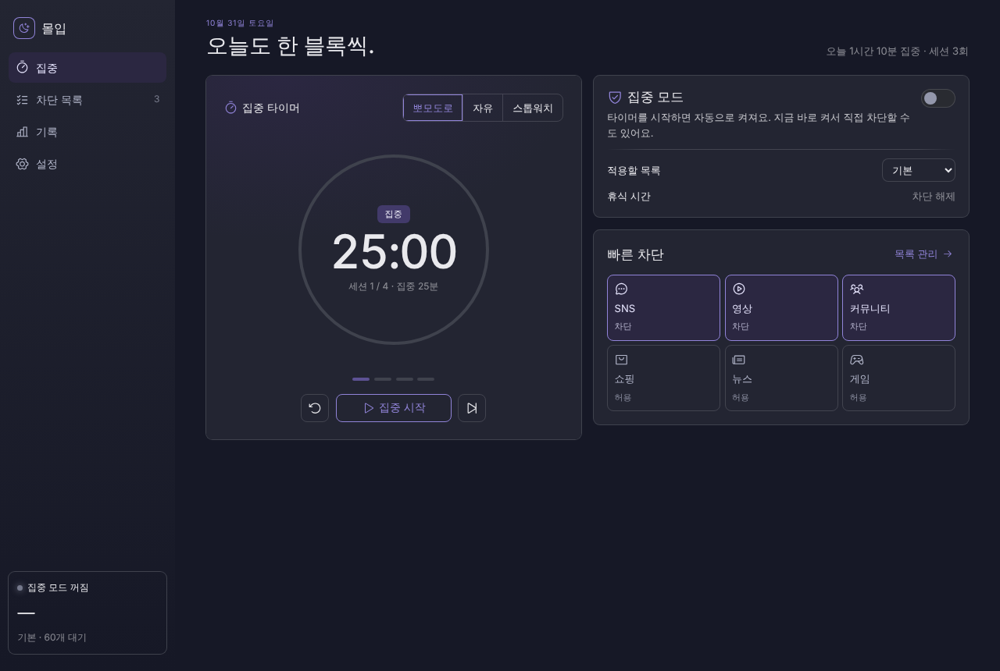 | 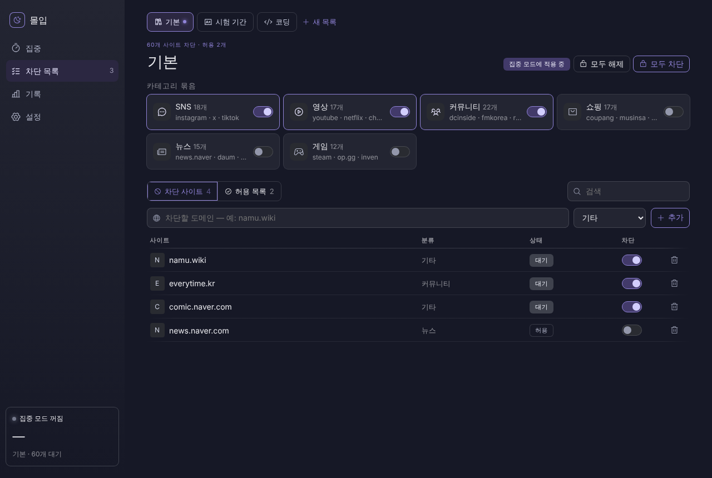 | 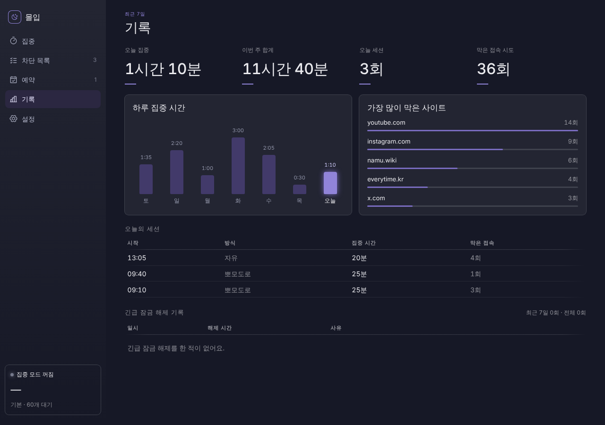 |
| **설정** | **해제 대기 대화상자** | **차단 화면** |
| 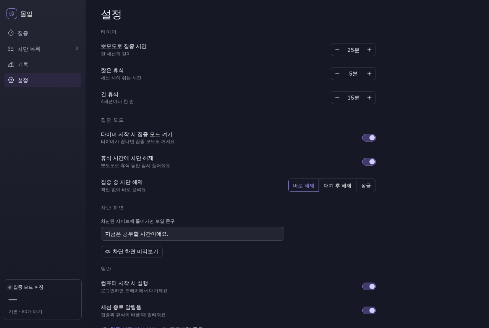 | 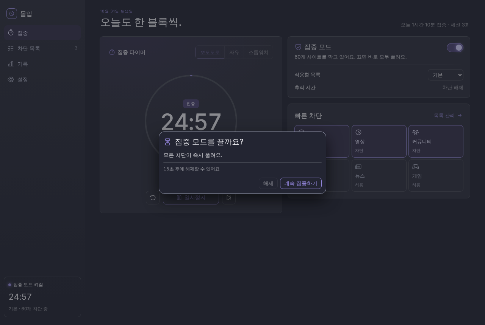 | 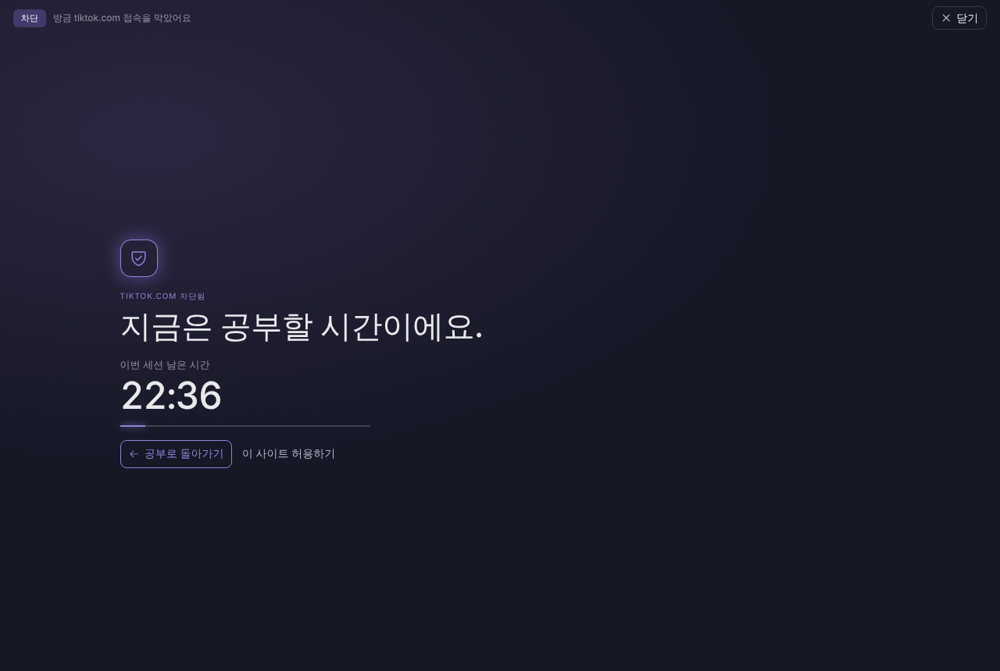 |
| **예약** | **긴급 잠금 해제** | **긴급 해제 기록** |
| 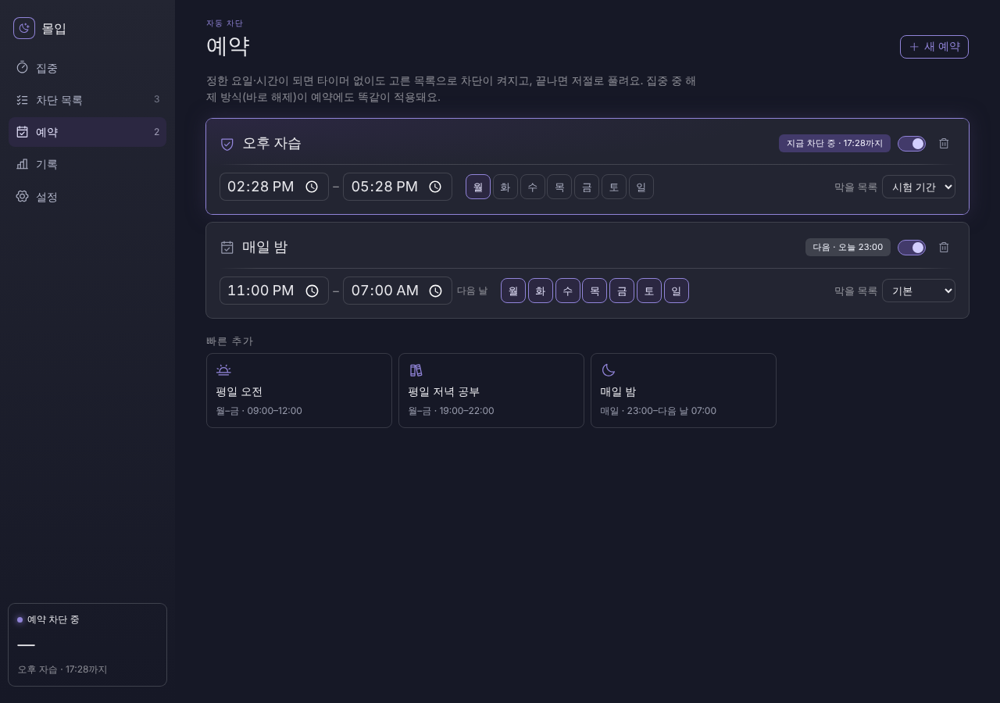 | 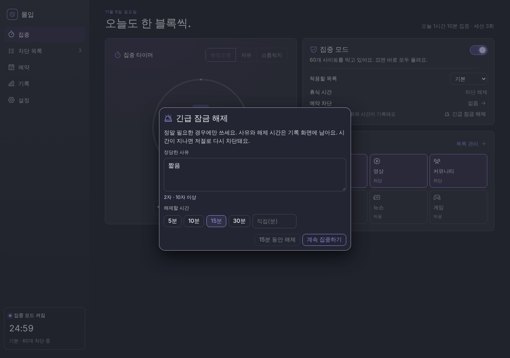 | 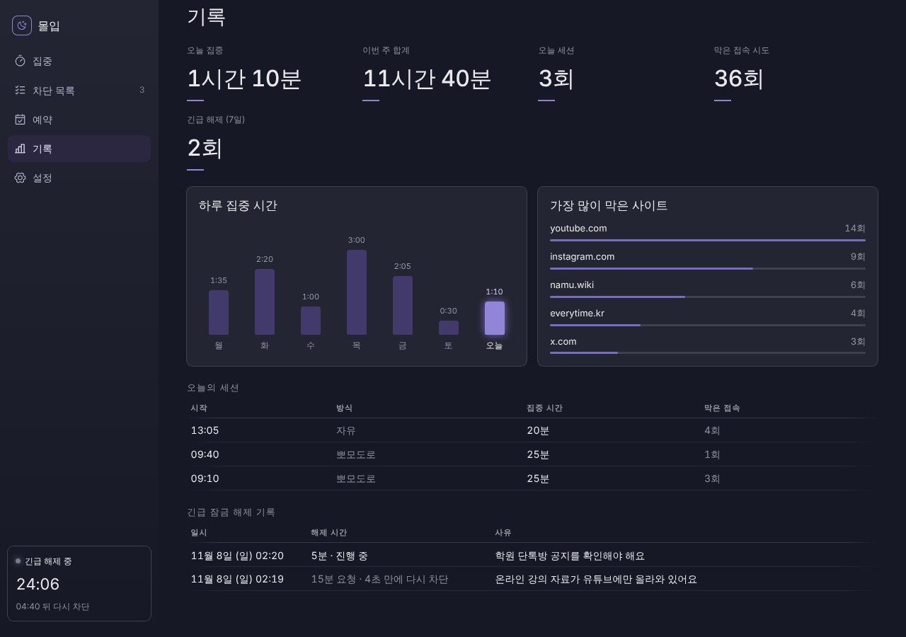 |

## 안드로이드 (APK)

- 설치: `dist/StudyBlocker.apk`를 폰으로 옮겨 설치 ("출처를 알 수 없는 앱 설치" 허용 필요)
- 처음 차단을 켤 때 VPN 연결 요청이 뜨면 "확인" (DNS 질의만 처리하며, 다른 트래픽은 그대로 통과)
- 앱 차단(유튜브·인스타 앱 등): 설정 > 접근성에서 '공부 집중 차단기'를 켜면, 차단 중 목록의 앱을 열 때 홈 화면으로 돌려보냄. '차단할 앱 선택'에서 앱 추가/삭제
- 예약: '예약' 탭에서 요일·시간대를 정하면 앱을 열지 않아도 그 시간에 사이트·앱을 자동 차단(밤을 넘기는 시간대 가능, 템플릿: 평일 오전·평일 저녁·매일 밤). 적용 중인 예약은 끝날 때까지 끄거나 지우거나 시간을 바꿀 수 없음
- 긴급 잠금 해제: 집중 중이거나 예약 시간에 '긴급 잠금 해제' 버튼 → 사유(10자 이상)와 시간(1~60분) 입력 → 그 시간 동안 사이트·앱 차단을 멈추고 자동으로 다시 차단. '기록' 탭에서 언제·몇 분(요청/실제)·무슨 사유였는지 확인
- 집중 모드/수동 차단/사이트 추가·삭제는 Windows 버전과 동일하게 동작
- 차단 앱을 열면 '딴짓 금지' 전체 화면과 남은 시간이 뜸
- 재빌드: `cd android && ./gradlew assembleRelease` → `app/build/outputs/apk/release/app-release.apk`
  (서명 키는 `android/keystore/`에 포함돼 있어 어디서 빌드해도 기존 앱 위에 업데이트 설치됨)
- 화면 스크린샷 갱신: `./gradlew recordPaparazziDebug`

### 필요한 권한

앱을 처음 열면 권한 설정 화면이 뜹니다. 나중에는 메인 화면 오른쪽 위 **[권한]** 버튼으로 다시 열 수 있습니다.

| 권한 | 구분 | 용도 | 허용 방법 |
|---|---|---|---|
| VPN 연결 | 필수 | 웹사이트 차단 (기기 안에서 DNS 요청만 걸러냄) | [허용] → 시스템 창에서 확인 |
| 접근성 | 필수 | 앱 차단 (열린 앱 이름만 확인, 화면 내용은 읽지 않음) | [설정 열기] → '공부 집중 차단기' 켜기 |
| 배터리 최적화 제외 | 권장 | 절전 중에 차단이 꺼지지 않게 함 | [허용] → 시스템 창에서 허용 |
| 항상 켜진 VPN | 선택 | 재부팅·강제 종료 후에도 차단 자동 재시작 | [VPN 설정 열기] → ⚙ → '항상 켜진 VPN' |
| 인터넷 / 부팅 완료 / 앱 목록 보기 / 정확한 알람 | 자동 | 주소 전달 / 재부팅 후 이어가기 / 차단할 앱 고르기 / 예약 시각에 차단 켜기 | 설치 시 자동 허용 |

> 안드로이드 13 이상에서 접근성 스위치가 회색으로 잠겨 있으면: 권한 화면의 **[앱 정보 열기]** → 오른쪽 위 ⋮ → **'제한된 설정 허용'** → 다시 접근성에서 켜기.
> (파일로 직접 설치한 앱에 안드로이드가 거는 보안 제한입니다.)

| 꺼짐(처음 실행) | 집중 중 | 수동 차단 | 차단 화면 | 권한 설정 | 예약 | 긴급 해제 |
|---|---|---|---|---|---|---|
| 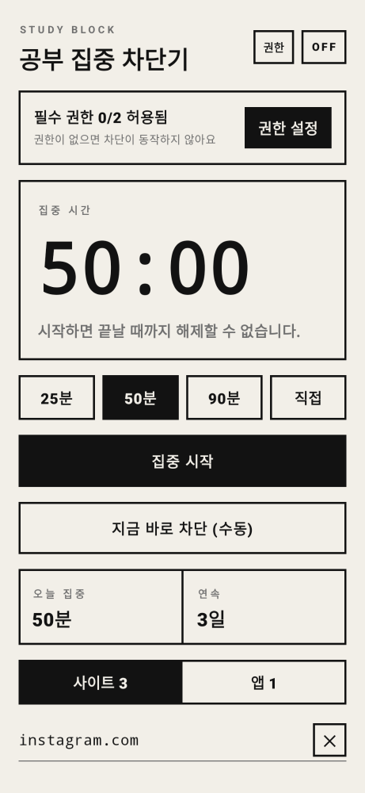 | 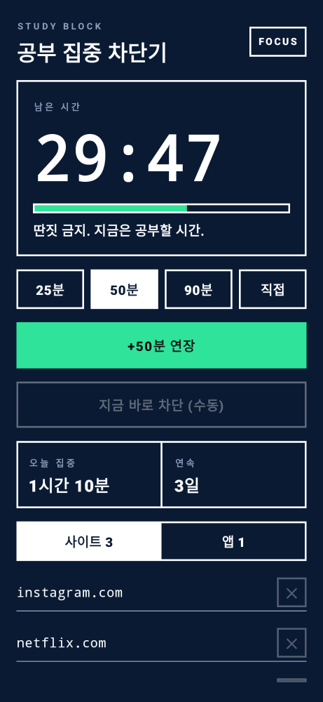 | 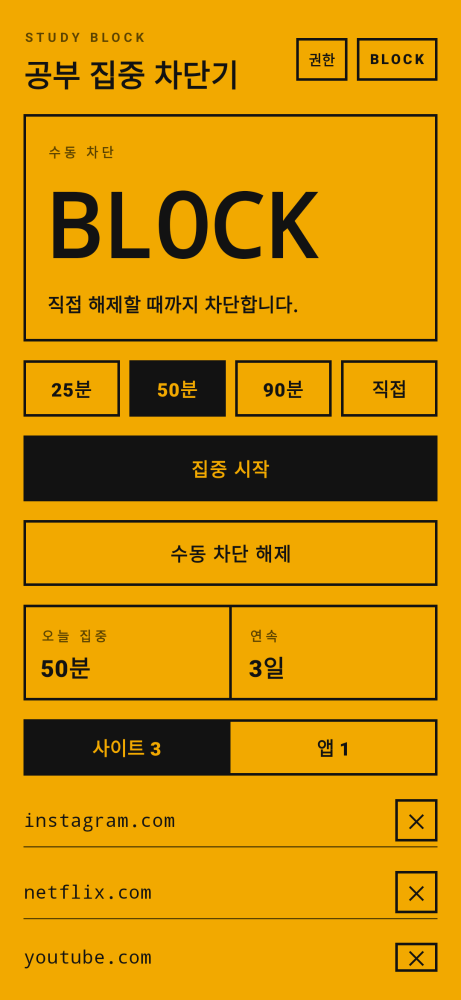 | 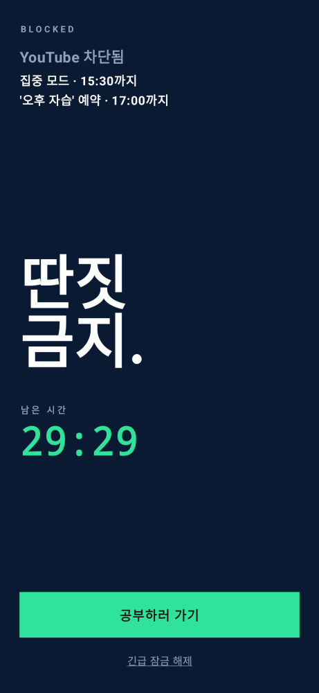 | 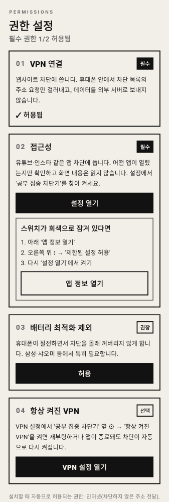 | 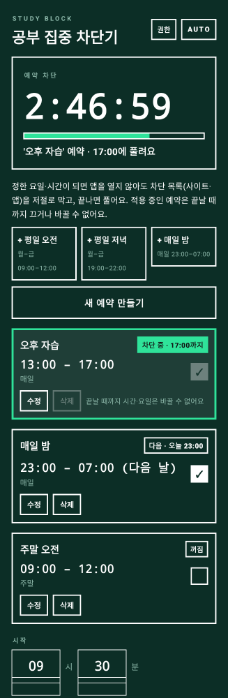 | 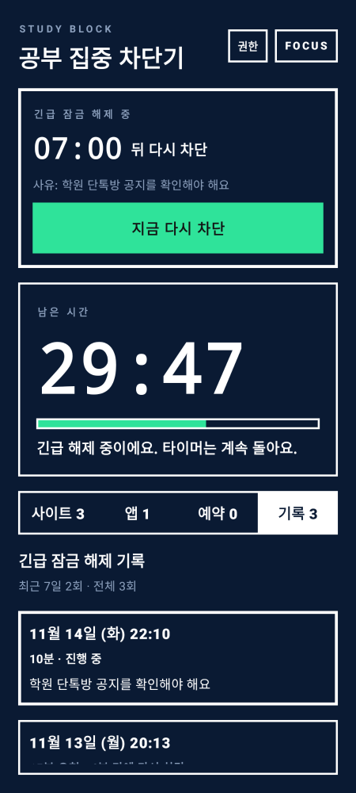 |
